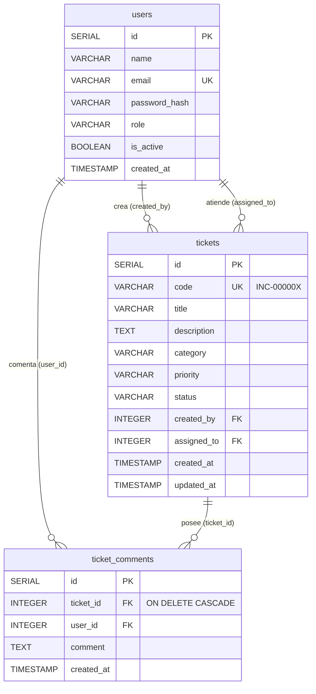

# 🎫 Helpdesk IT — Enterprise Ticketing & Cloud Architecture

[](https://helpdesk.erickduarte.tech)
[](https://api-helpdesk.erickduarte.tech/api)
[](https://k3s.io/)
[](https://github.com/ErickDuarte00/helpdesk-core-/actions)
[](https://www.terraform.io/)
[](https://www.postgresql.org/)

Plataforma full-stack corporativa para la gestión, priorización y auditoría del ciclo de vida de tickets de soporte técnico de TI. Diseñada bajo una arquitectura cliente-servidor desacoplada, seguridad granular basada en roles (**RBAC**), control transaccional estricto (**ACID**) y despliegue automatizado en la nube con **Kubernetes (K3s)**, **Cloudflare Zero Trust** y **Terraform** sobre **AWS**.

---

## ⚡ Acceso Rápido / Demo en Vivo (One-Click Login)

Para facilitar la evaluación técnica sin requerir registro manual de credenciales, el sistema soporta **autenticación automática por URL** y botones de acceso directo en la interfaz:

| Rol de Demostración | URL de Acceso Directo (1 Clic) | Permisos y Alcance Operativo |
| :--- | :--- | :--- |
| 🛡️ **Administrador** | [helpdesk.erickduarte.tech/?demo=admin](https://helpdesk.erickduarte.tech/?demo=admin) | Control total, métricas corporativas, borrado de tickets y gestión de usuarios (Soft Delete). |
| 🔧 **Técnico de Soporte** | [helpdesk.erickduarte.tech/?demo=tecnico](https://helpdesk.erickduarte.tech/?demo=tecnico) | Gestión global de tickets, filtrado por asignación ("Mis tickets", "Sin asignar") y actualización de estados. |
| 👤 **Empleado (Solicitante)** | [helpdesk.erickduarte.tech/?demo=empleado](https://helpdesk.erickduarte.tech/?demo=empleado) | Aislamiento estricto de incidencias personales, apertura de solicitudes y notas de seguimiento. |

---

## 🌟 Características Principales

- **Gestión Integral de Incidencias:** Apertura, categorización, asignación técnica, cambio de estados (*Abierto*, *En progreso*, *Resuelto*, *Cerrado*) y bitácora cronológica auditable.
- **Transaccionalidad Atómica (ACID):** Creación de tickets en un bloque transaccional SQL (`BEGIN/COMMIT/ROLLBACK`), garantizando la emisión correlativa del código de negocio (`INC-00000X`) y el registro simultáneo de apertura.
- **Control de Acceso Basado en Roles (RBAC):** Middleware de seguridad con tolerancia a variaciones léxicas y sinónimos (`admin`/`administrador`), aislando vistas e inyectando restricciones a nivel base de datos para solicitantes.
- **Soft Delete con Integridad Referencial:** Desactivación lógica de cuentas para evitar la orfandad de registros y bloqueo estricto de borrado físico ante usuarios con historial de tickets o comentarios.
- **Dashboard y KPIs en Tiempo Real:** Métricas agregadas con `COUNT(*) FILTER` en PostgreSQL (tickets abiertos, en curso, críticos del día y resueltos hoy).
- **Protección de Sesión Anti-Caché:** Guardián de sesión en frontend que intercepta el ciclo de vida del navegador (`pageshow`) e impide el reingreso vía botón "Atrás" tras cerrar sesión.

---

## 📐 Arquitectura del Sistema e Infraestructura Cloud

```
[ Navegador / Cliente ]
          │  HTTPS / TLS 1.3
          ▼
   [ Cloudflare Edge ] (erickduarte.tech)
          │
          │ Túnel cifrado de salida (cloudflared Zero Trust)
          ▼
    [ AWS EC2 ] ──── (Firewall / Security Group: 0 puertos públicos expuestos)
          │
      [ Clúster K3s (Kubernetes) ]
     ┌────┴───────────────────────────┐
     ▼                                ▼
[ Pod Frontend ]              [ Pod Backend API ]
 (Astro 7 / SSR / Tailwind v4)  (Express 5 / Node.js 22)
     │                                │
     │ (Consumo REST)                 │ (Pool pg con SSL Dinámico)
     └────────────────────────────────┼──────────┐
                                                 ▼
                                     [ Supabase PostgreSQL 16 ]
                                        (AWS ca-central-1)
```

### Seguridad de Red & Edge
- **Cloudflare Zero Trust Tunnel:** La instancia EC2 en AWS no expone puertos HTTP/HTTPS abiertos a internet (`0.0.0.0/0`). El tráfico se canaliza mediante un demonio seguro `cloudflared` de salida hacia el Edge de Cloudflare, mitigando ataques directos por escaneo de IPs y DDoS.
- **Memoria Swap Automatizada:** Aprovisionamiento de 2 GB de Swap en AWS EC2 mediante scripts de inicio (*cloud-init*) para proteger el clúster frente a eventos de saturación de memoria (*OOM*).

---

## 🛠️ Stack Tecnológico

| Capa | Tecnologías | Uso en el Sistema |
| :--- | :--- | :--- |
| **Frontend** | Astro 7, TypeScript, Tailwind CSS v4, HTML5 | Interfaz responsiva moderna, consumo asíncrono y layouts protegidos. |
| **Backend API** | Node.js 22, Express.js 5, JavaScript ESM | Arquitectura modular Router-Controller-Data Access con soporte nativo de promesas. |
| **Base de Datos** | PostgreSQL 16, node-postgres (`pg`) | Consultas SQL parametrizadas puras, transacciones atómicas y agregaciones analíticas. |
| **Seguridad** | JWT (`jsonwebtoken`), bcrypt | Tokens stateless con expiración a 8h y hashing seguro con factor de coste 10. |
| **Orquestación** | Kubernetes (K3s), Docker | Manifiestos declarativos (`Deployments`, `Services`, `Secrets`) y recursos delimitados. |
| **Infraestructura (IaC)** | Terraform | Aprovisionamiento automatizado de EC2, IP Elástica y reglas de red en AWS. |
| **CI/CD & Registro** | GitHub Actions, GHCR (`ghcr.io`) | Compilación automática, validación sintáctica, construcción y publicación de contenedores. |

---

## 📂 Estructura del Repositorio

```text
project-tickets/
├── .github/workflows/
│   └── ci-cd.yml             # Pipeline de CI/CD: build, testing, docker push y deploy
├── helpdesk-core/             # Backend REST API (Node.js & Express 5)
│   ├── src/
│   │   ├── config/db.js       # Pool PostgreSQL con detección inteligente de SSL
│   │   ├── controllers/       # Lógica de negocio (auth, tickets, users)
│   │   ├── middlewares/       # JWT auth & RBAC granular
│   │   ├── routes/            # Enrutadores HTTP REST
│   │   └── app.js             # Punto de entrada y middlewares globales
│   ├── database/schema.sql    # DDL del esquema relacional
│   └── Dockerfile             # Imagen optimizada Node.js Alpine
├── helpdesk-frontend/         # Frontend Web (Astro 7 & Tailwind CSS v4)
│   ├── src/
│   │   ├── layouts/           # Plantilla base y Session Guard anti-historial
│   │   └── pages/             # Vistas de autenticación y paneles (/admin, /tecnico, /empleado)
│   └── Dockerfile             # Imagen para ejecución y renderizado web
├── k8s/                       # Manifiestos de Kubernetes para K3s
│   ├── frontend.yaml          # Deployment y Service del frontend
│   ├── backend.yaml           # Deployment y Service de la API
│   └── secret.yaml            # Secretos de producción
├── terraform/                 # Infraestructura como Código (AWS)
│   ├── main.tf                # Definición de EC2, EIP y Security Groups
│   ├── user_data.sh           # Cloud-init: Swap 2GB, Docker y dependencias
│   └── variables.tf           # Variables de aprovisionamiento
├── init-db/
│   └── init.sql               # Esquema inicial y datos de prueba (seeds)
└── docker-compose.yml         # Entorno multi-contenedor local de desarrollo
```

---

## 🗄️ Modelo Relacional de Datos



---

## 🚀 Instalación y Ejecución Local

### Prerrequisitos
- [Docker](https://www.docker.com/) y [Docker Compose](https://docs.docker.com/compose/) instalados.
- [Node.js](https://nodejs.org/) v20+ (opcional para desarrollo sin contenedores).

### Opción 1: Despliegue Inmediato con Docker Compose (Recomendado)
Levanta toda la plataforma (Base de datos PostgreSQL, Backend y Frontend) con semillas de prueba pre-cargadas:

```bash
# 1. Clonar el repositorio
git clone https://github.com/ErickDuarte00/helpdesk-core-.git
cd helpdesk-core-

# 2. Configurar variables de entorno
cp .env.example .env

# 3. Construir y levantar los servicios
docker compose up --build -d
```

Puntos de acceso locales:
- **Frontend Web:** [http://localhost:4321](http://localhost:4321)
- **Backend API:** [http://localhost:3000/health](http://localhost:3000/health)
- **PostgreSQL:** `localhost:5432`

### Opción 2: Desarrollo Local por Módulos
```bash
# Backend (helpdesk-core)
cd helpdesk-core
npm install
npm run dev

# Frontend (helpdesk-frontend)
cd ../helpdesk-frontend
npm install
npm run dev
```

---

## 🔐 Seguridad y Mejores Prácticas

- **Mitigación de SQL Injection:** Parámetros estrictamente separados del árbol sintáctico SQL mediante placeholders (`$1, $2, ...`) con el driver nativo `node-postgres`.
- **Criptografía Robusta:** Hashing de contraseñas mediante `bcrypt` con 10 rondas de salado irreversibles.
- **Autenticación sin Estado:** Tokens JWT firmados con algoritmo HS256 y vigencia de 8 horas.
- **Protección Contra Elevación de Privilegios:** RBAC validado en servidor antes de procesar cualquier mutación en la base de datos.
- **Principio de Menor Privilegio en Red:** Cero puertos entrantes expuestos en AWS gracias al enrutamiento perimetral con túneles Cloudflare.

---

## 👤 Autor

**Erick Duarte**  
- **Sitio Web:** [erickduarte.tech](https://erickduarte.tech)  
- **GitHub:** [@ErickDuarte00](https://github.com/ErickDuarte00)  
- **LinkedIn:** [Erick Duarte](https://linkedin.com/in/erickduarte00)
